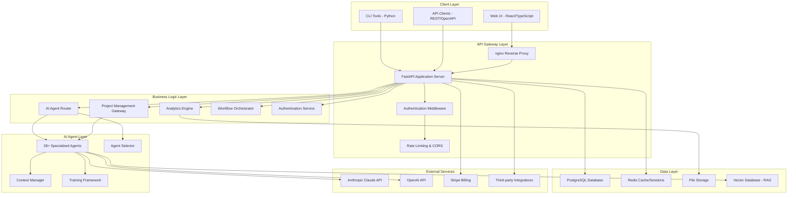
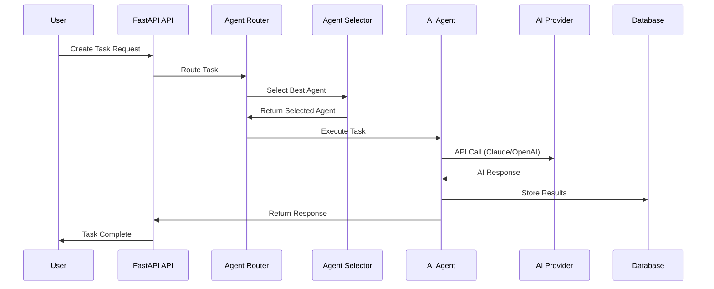
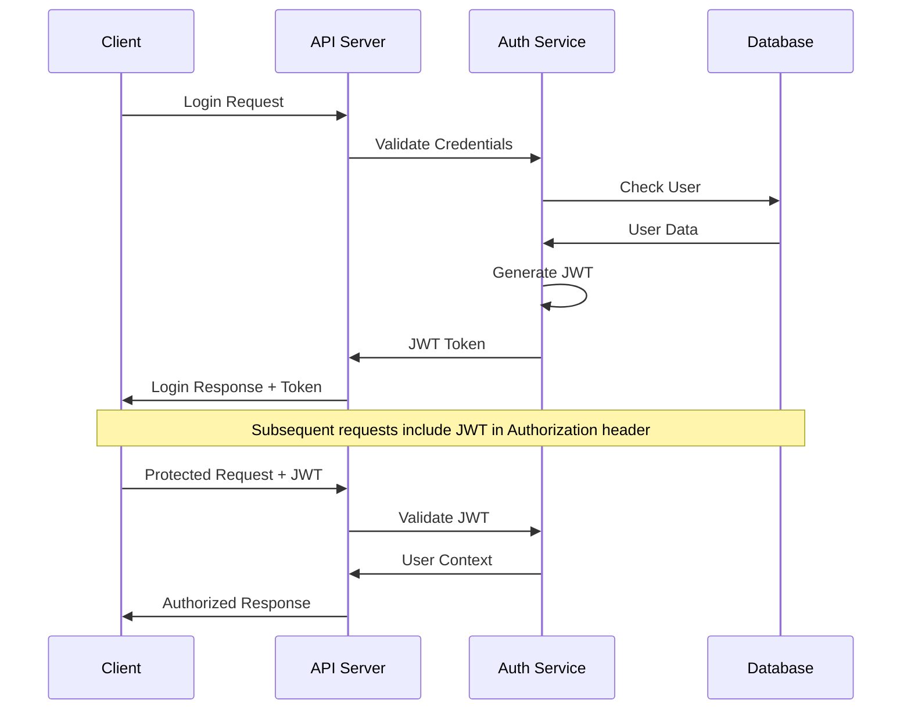

# 🏗️ AI-CRM System Architecture

## 📊 Overview

**AI-CRM** is a modern, cloud-native CRM and project management system powered by AI agents. The system follows a **3-layer architecture** with **microservices patterns**, designed for scalability, security, and maintainability.

**Current Version**: Phase 2A (Production Ready)  
**Architecture Style**: Event-driven microservices with AI agent orchestration  
**Deployment**: Containerized with Docker + nginx reverse proxy

---

## 🏛️ High-Level Architecture



---

## 🔧 Technology Stack

### **Frontend (Phase 2B)**
- **Framework**: React 18+ with TypeScript
- **Build Tool**: Bun (fast JavaScript runtime)
- **UI Library**: Modern component library
- **State Management**: React Context + hooks
- **Styling**: CSS modules + Tailwind CSS

### **Backend (Current - Phase 2A)**
- **API Framework**: FastAPI 0.104+ (Python 3.11+)
- **ASGI Server**: Uvicorn with hot-reload
- **Authentication**: JWT with Argon2 password hashing
- **Validation**: Pydantic v2 for data validation
- **Database ORM**: SQLAlchemy 2.0+ with async support

### **Database & Storage**
- **Primary Database**: PostgreSQL 15+ (production)
- **Development Database**: SQLite (development)
- **Cache/Sessions**: Redis 6.4+
- **File Storage**: Local filesystem (Phase 2A), S3-compatible (Phase 2B)
- **Vector Database**: Planned for RAG system (Phase 2B)

### **AI & Machine Learning**
- **Primary AI**: Anthropic Claude (Claude-3)
- **Secondary AI**: OpenAI GPT models (optional)
- **Vector Processing**: sentence-transformers + faiss (Phase 2B)
- **Agent Framework**: Custom multi-agent orchestration

### **Infrastructure & DevOps**
- **Containerization**: Docker with multi-stage builds
- **Reverse Proxy**: nginx with security headers
- **Process Management**: Supervisor (in containers)
- **Package Management**: uv (fast Python package manager)
- **Code Quality**: ruff (linting), mypy (type checking), black (formatting)

### **Monitoring & Observability**
- **Metrics**: Prometheus + Grafana
- **Health Checks**: Built-in FastAPI health endpoints
- **Logging**: Structured JSON logging
- **Security Scanning**: safety, bandit

---

## 🧱 Component Architecture

### **1. API Gateway Layer**

#### nginx Reverse Proxy
```nginx
upstream backend {
    server localhost:5001;
}

server {
    listen 80;
    # Security headers
    add_header X-Frame-Options DENY;
    add_header X-Content-Type-Options nosniff;
    
    # Static file serving
    location / {
        root /app/static;
        try_files $uri $uri/ /index.html;
    }
    
    # API proxy
    location /api {
        proxy_pass http://backend;
        proxy_set_header X-Forwarded-For $proxy_add_x_forwarded_for;
    }
}
```

#### FastAPI Application
```python
app = FastAPI(
    title="AI-CRM API",
    description="AI-powered CRM and project management",
    version="2.0.0"
)

# Middleware stack
app.add_middleware(CORSMiddleware, ...)
app.add_middleware(AuthenticationMiddleware)
app.add_middleware(RateLimitMiddleware)

# Route organization
app.include_router(auth_router, prefix="/api/auth")
app.include_router(agents_router, prefix="/api/agents")
app.include_router(tasks_router, prefix="/api/tasks")
```

### **2. Authentication & Security**

#### JWT-based Authentication
```python
# Secure password hashing with Argon2
pwd_context = CryptContext(
    schemes=["argon2"],
    argon2__memory_cost=65536,  # 64 MB
    argon2__time_cost=3,
    argon2__parallelism=1,
)

# JWT token management
def create_access_token(data: dict):
    to_encode = data.copy()
    expire = datetime.utcnow() + timedelta(minutes=30)
    to_encode.update({"exp": expire})
    return jwt.encode(to_encode, SECRET_KEY, algorithm="HS256")
```

#### Role-Based Access Control (RBAC)
```python
class UserRole(enum.Enum):
    ADMIN = "admin"
    USER = "user"
    READONLY = "readonly"

class SubscriptionTier(enum.Enum):
    FREE = "free"
    PRO = "pro" 
    ENTERPRISE = "enterprise"

@require_permission("agents:create")
async def create_agent_task():
    # Protected endpoint
    pass
```

### **3. AI Agent System**

#### Agent Architecture
```python
class BaseAgent:
    def __init__(self, name: str, capabilities: List[str]):
        self.name = name
        self.capabilities = capabilities
        self.api_client = self._get_api_client()
    
    async def process_task(self, task: Task) -> AgentResponse:
        # Standardized agent interface
        pass

class AgentRouter:
    def __init__(self):
        self.agents = self._load_agents()
        self.selector = AgentSelector()
    
    async def route_task(self, task: Task) -> Agent:
        return await self.selector.select_best_agent(task, self.agents)
```

#### Available Agents (Phase 2A)
```
📊 Analytics Agents:
- Business Analytics Agent
- Performance Monitoring Agent
- Data Visualization Agent

🤖 Development Agents:
- Code Review Agent
- Documentation Agent
- Testing Agent
- Deployment Agent

🎯 Project Management Agents:
- PM Gateway Agent
- Task Prioritization Agent
- Resource Planning Agent
- Timeline Management Agent

🔒 Security Agents:
- Security Audit Agent
- Vulnerability Scanner Agent
- Compliance Check Agent

💰 Business Agents:
- Sales Process Agent
- Customer Support Agent
- Billing Management Agent
```

### **4. Database Architecture**

#### Database Schema (Core Tables)
```sql
-- User Management
CREATE TABLE users (
    id SERIAL PRIMARY KEY,
    username VARCHAR(50) UNIQUE NOT NULL,
    email VARCHAR(255) UNIQUE NOT NULL,
    password_hash VARCHAR(255) NOT NULL,
    role user_role NOT NULL DEFAULT 'user',
    subscription_tier subscription_tier NOT NULL DEFAULT 'free',
    created_at TIMESTAMP DEFAULT NOW()
);

-- Task Management
CREATE TABLE tasks (
    id SERIAL PRIMARY KEY,
    title VARCHAR(255) NOT NULL,
    description TEXT,
    status task_status NOT NULL DEFAULT 'pending',
    assigned_agent VARCHAR(100),
    created_by INTEGER REFERENCES users(id),
    created_at TIMESTAMP DEFAULT NOW()
);

-- Agent Execution History
CREATE TABLE agent_executions (
    id SERIAL PRIMARY KEY,
    task_id INTEGER REFERENCES tasks(id),
    agent_name VARCHAR(100) NOT NULL,
    input_data JSONB,
    output_data JSONB,
    execution_time INTEGER, -- milliseconds
    status execution_status NOT NULL,
    created_at TIMESTAMP DEFAULT NOW()
);
```

#### Connection Management
```python
# SQLAlchemy 2.0 async setup
engine = create_async_engine(
    DATABASE_URL,
    echo=False,
    pool_pre_ping=True,
    pool_recycle=3600,
)

async_session = async_sessionmaker(
    engine, 
    class_=AsyncSession,
    expire_on_commit=False
)
```

---

## 🔄 Data Flow Architecture

### **1. Request Flow**
```
User Request → nginx → FastAPI → Auth Middleware → Route Handler → Business Logic → Agent Router → AI Agent → Database → Response
```

### **2. Agent Execution Flow**


### **3. Authentication Flow**


---

## 🚀 Deployment Architecture

### **Phase 2A - Single Node Deployment**
```yaml
# docker-compose.phase2a.yml
services:
  aicrm-app:           # Main application
    image: aicrm:latest
    ports: ["8080:80"]
    depends_on: [postgres, redis]
    
  postgres:            # Primary database
    image: postgres:15
    volumes: ["pgdata:/var/lib/postgresql/data"]
    
  redis:               # Cache and sessions
    image: redis:7-alpine
    
  # Optional monitoring
  prometheus:          # Metrics collection
    image: prom/prometheus
    
  grafana:            # Monitoring dashboard
    image: grafana/grafana
```

### **Phase 2B - Microservices (Planned)**
```yaml
services:
  # Frontend
  frontend:
    image: aicrm-frontend:latest
    
  # API Gateway
  api-gateway:
    image: nginx:alpine
    
  # Core Services
  auth-service:
    image: aicrm-auth:latest
    
  agent-service:
    image: aicrm-agents:latest
    
  task-service:
    image: aicrm-tasks:latest
    
  # Data Layer
  postgres:
    image: postgres:15
    
  redis:
    image: redis:7
    
  vector-db:
    image: weaviate/weaviate
```

### **Phase 3 - Multi-Region (Future)**
```
Load Balancer (Global)
├── Region 1 (US-East)
│   ├── Kubernetes Cluster
│   ├── PostgreSQL (Primary)
│   └── Redis Cluster
├── Region 2 (EU-West)
│   ├── Kubernetes Cluster
│   ├── PostgreSQL (Read Replica)
│   └── Redis Cluster
└── Region 3 (Asia-Pacific)
    ├── Kubernetes Cluster
    ├── PostgreSQL (Read Replica)
    └── Redis Cluster
```

---

## 🔒 Security Architecture

### **Defense in Depth**
```
┌─────────────────────────────────────────┐
│ 1. Network Security                     │
│   • nginx reverse proxy                 │
│   • Rate limiting                       │
│   • DDoS protection                     │
└─────────────────────────────────────────┘
┌─────────────────────────────────────────┐
│ 2. Application Security                 │
│   • CORS configuration                  │
│   • Security headers                    │
│   • Input validation (Pydantic)         │
└─────────────────────────────────────────┘
┌─────────────────────────────────────────┐
│ 3. Authentication & Authorization       │
│   • JWT tokens                          │
│   • Argon2 password hashing             │
│   • Role-based access control           │
└─────────────────────────────────────────┘
┌─────────────────────────────────────────┐
│ 4. Data Security                        │
│   • Database encryption at rest         │
│   • TLS encryption in transit           │
│   • Secrets management                  │
└─────────────────────────────────────────┘
```

### **Security Headers (nginx)**
```nginx
add_header X-Frame-Options "DENY";
add_header X-Content-Type-Options "nosniff";
add_header X-XSS-Protection "1; mode=block";
add_header Strict-Transport-Security "max-age=31536000; includeSubDomains";
add_header Content-Security-Policy "default-src 'self'; script-src 'self' 'unsafe-inline'";
add_header Referrer-Policy "strict-origin-when-cross-origin";
```

---

## 📊 Performance Architecture

### **Caching Strategy**
```python
# Redis caching layers
@cache(expire=3600)  # 1 hour cache
async def get_user_permissions(user_id: int):
    return await db.query(UserPermissions).filter_by(user_id=user_id).all()

@cache(expire=300)   # 5 minute cache
async def get_agent_capabilities():
    return await agent_registry.get_all_capabilities()
```

### **Database Optimization**
```sql
-- Optimized indexes
CREATE INDEX idx_tasks_user_status ON tasks(created_by, status);
CREATE INDEX idx_agent_executions_task ON agent_executions(task_id);
CREATE INDEX idx_users_email ON users(email);

-- Partitioning for large tables (Phase 2B)
CREATE TABLE agent_executions_2025_08 PARTITION OF agent_executions
    FOR VALUES FROM ('2025-08-01') TO ('2025-09-01');
```

---

## 🔌 Integration Architecture

### **AI Provider Integration**
```python
class AIProviderInterface:
    async def complete_task(self, prompt: str, context: dict) -> str:
        pass

class AnthropicProvider(AIProviderInterface):
    def __init__(self, api_key: str):
        self.client = anthropic.Anthropic(api_key=api_key)
    
    async def complete_task(self, prompt: str, context: dict) -> str:
        response = await self.client.messages.create(
            model="claude-3-sonnet-20240229",
            max_tokens=1024,
            messages=[{"role": "user", "content": prompt}]
        )
        return response.content[0].text
```

### **External API Integration**
```python
# Billing integration (Stripe)
@app.post("/api/billing/create-subscription")
async def create_subscription(user: User, plan: SubscriptionPlan):
    stripe_customer = stripe.Customer.create(email=user.email)
    subscription = stripe.Subscription.create(
        customer=stripe_customer.id,
        items=[{"price": plan.stripe_price_id}]
    )
    return subscription

# Webhook handling
@app.post("/api/webhooks/stripe")
async def handle_stripe_webhook(request: Request):
    payload = await request.body()
    sig_header = request.headers.get("stripe-signature")
    
    event = stripe.Webhook.construct_event(
        payload, sig_header, STRIPE_WEBHOOK_SECRET
    )
    
    if event["type"] == "invoice.payment_succeeded":
        await handle_payment_success(event["data"]["object"])
```

---

## 📈 Scalability Considerations

### **Current Limitations (Phase 2A)**
- **Single-node deployment**: All services on one server
- **SQLite for development**: Not suitable for concurrent users
- **In-memory agent state**: Lost on restart
- **File-based storage**: Limited scalability

### **Scaling Strategy (Phase 2B+)**
```python
# Horizontal scaling with Redis Cluster
redis_cluster = RedisCluster(
    startup_nodes=[
        {"host": "redis-node-1", "port": "7000"},
        {"host": "redis-node-2", "port": "7000"},
        {"host": "redis-node-3", "port": "7000"},
    ]
)

# Database read replicas
class DatabaseRouter:
    def __init__(self):
        self.primary = create_engine(PRIMARY_DB_URL)
        self.replicas = [
            create_engine(REPLICA_1_URL),
            create_engine(REPLICA_2_URL),
        ]
    
    def get_read_engine(self):
        return random.choice(self.replicas)
    
    def get_write_engine(self):
        return self.primary
```

---

## 🎯 Future Architecture (Phase 2B/3)

### **Microservices Decomposition**
```
Authentication Service    → User management, JWT tokens
Agent Service            → AI agent orchestration  
Task Service             → Task lifecycle management
Analytics Service        → Business intelligence
Notification Service     → Email, SMS, webhooks
File Service             → Document storage, processing
Billing Service          → Subscription management
```

### **Event-Driven Architecture**
```python
# Event bus with Redis Streams
class EventBus:
    async def publish(self, event_type: str, data: dict):
        await redis.xadd(
            f"events:{event_type}",
            {"data": json.dumps(data)}
        )
    
    async def subscribe(self, event_type: str, handler):
        async for message in redis.xread({f"events:{event_type}": "$"}):
            await handler(message)

# Usage
await event_bus.publish("task.created", {
    "task_id": task.id,
    "user_id": task.created_by,
    "agent_type": task.assigned_agent
})
```

---

## 📋 Architecture Decision Records (ADRs)

### **ADR-001: FastAPI over Flask**
**Decision**: Use FastAPI for the backend API framework  
**Reasoning**: 
- Native async/await support
- Automatic OpenAPI documentation
- Pydantic integration for validation
- Better performance than Flask
- Type hints support

### **ADR-002: PostgreSQL over MongoDB**
**Decision**: Use PostgreSQL as primary database  
**Reasoning**:
- ACID compliance for financial data
- Strong ecosystem and tooling
- JSON support for flexible schemas
- Proven scalability
- SQL familiarity

### **ADR-003: JWT over Session Cookies**
**Decision**: Use JWT tokens for authentication  
**Reasoning**:
- Stateless authentication
- Better for API clients
- Mobile app support
- Microservices compatibility
- Scalability benefits

### **ADR-004: uv over pip**
**Decision**: Use uv as Python package manager  
**Reasoning**:
- 10-100x faster than pip
- Better dependency resolution
- Lock file support
- Modern Python tooling
- Better developer experience

---

## 🔍 Monitoring & Observability

### **Metrics Collection**
```python
from prometheus_client import Counter, Histogram, Gauge

# Request metrics
REQUEST_COUNT = Counter("http_requests_total", "Total requests", ["method", "endpoint"])
REQUEST_DURATION = Histogram("http_request_duration_seconds", "Request duration")

# Agent metrics
AGENT_EXECUTIONS = Counter("agent_executions_total", "Agent executions", ["agent", "status"])
AGENT_DURATION = Histogram("agent_execution_duration_seconds", "Agent execution time")

# System metrics
ACTIVE_USERS = Gauge("active_users_total", "Currently active users")
```

### **Health Checks**
```python
@app.get("/health")
async def health_check():
    checks = {
        "database": await check_database(),
        "redis": await check_redis(),
        "ai_providers": await check_ai_providers(),
        "disk_space": check_disk_space(),
    }
    
    status = "healthy" if all(checks.values()) else "unhealthy"
    return {"status": status, "checks": checks}
```

---

## 📚 Documentation Architecture

### **Documentation Structure**
```
docs/
├── guides/              # User guides and tutorials
│   ├── QUICKSTART.md
│   ├── USER_GUIDE.md
│   └── ONBOARDING_PROMPT.md
├── architecture/        # Technical architecture
│   ├── AI_INTEGRATION_GUIDE.md
│   ├── PM_GATEWAY_GUIDE.md
│   └── ANALYTICS_ARCHITECTURE.md
├── api/                 # API documentation
│   └── authentication.md
├── deployment/          # Deployment guides
└── reports/             # Status reports
```

### **API Documentation**
- **OpenAPI/Swagger**: Auto-generated from FastAPI
- **Interactive docs**: Available at `/docs` endpoint
- **Redoc**: Alternative documentation at `/redoc`
- **Postman collection**: Exported for testing

---

## 🎯 Summary

The AI-CRM system is built with **modern architecture principles**:

✅ **Scalable**: Designed for horizontal scaling  
✅ **Secure**: Defense-in-depth security strategy  
✅ **Maintainable**: Clean code, modular design  
✅ **Observable**: Comprehensive monitoring  
✅ **Testable**: Automated testing at all levels  
✅ **Documented**: Comprehensive documentation  

**Phase 2A** provides a **production-ready foundation** with enterprise-grade security and modern development practices. **Phase 2B/3** will add advanced AI capabilities, microservices architecture, and global scalability.

---

**Last Updated**: August 16, 2025  
**Architecture Version**: Phase 2A  
**Next Evolution**: Project restructuring for Phase 2B microservices